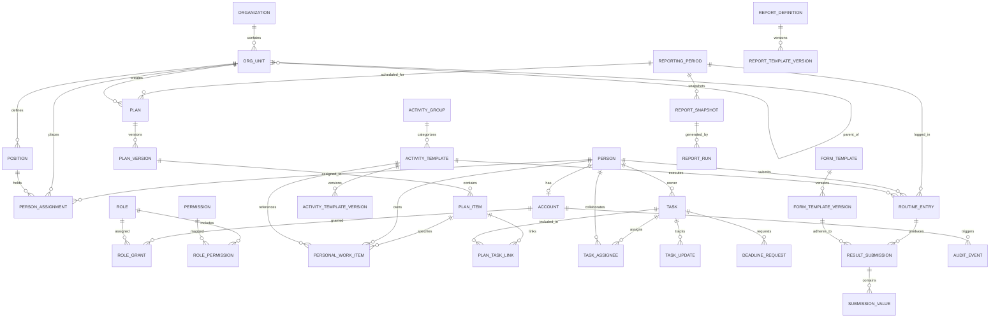

# KẾ HOẠCH TRIỂN KHAI HỆ THỐNG QUẢN LÝ KẾ HOẠCH & ĐIỀU HÀNH CÔNG VIỆC
## HẢI QUAN CỬA KHẨU QUỐC TẾ TÀ LÙNG (`talung-cus-work`)

> **Tài liệu Kiến trúc Phần mềm & Kế hoạch Phát triển Chi tiết (Implementation Plan & Technical Blueprint)**  
> **Phiên bản:** 1.0.0  
> **Ngày lập:** 09/10/2026  
> **Vai trò:** Senior Full-stack Engineer, Software Architect & Technical Lead  
> **Căn cứ gốc:** `PROJECT_CONTEXT.md` (v1.1.1) & Hướng dẫn thiết kế Google Stitch  
> **Trạng thái:** DRAFT — Trình duyệt trước khi bước vào giai đoạn lập trình mã nguồn chi tiết  

---

## MỤC LỤC

1. [Phân Tích Dự Án & Bối Cảnh Nghiệp Vụ (Context Analysis)](#1-phân-tích-dự-án--bối-cảnh-nghiệp-vụ-context-analysis)
   - 1.1. Mục tiêu và phạm vi hệ thống
   - 1.2. Hiện trạng file Excel gốc và bài toán chuẩn hóa dữ liệu
   - 1.3. Các nguyên tắc nghiệp vụ cốt lõi bắt buộc tuân thủ
   - 1.4. Phân loại 3 luồng công việc & 4 chế độ báo cáo
   - 1.5. Phân biệt các trạng thái nghiệp vụ chuẩn
2. [Đề Xuất Kiến Trúc Kỹ Thuật (Architecture & Tech Stack)](#2-đề-xuất-kiến-trúc-kỹ-thuật-architecture--tech-stack)
   - 2.1. Phong cách kiến trúc: Modular Monolith
   - 2.2. Lựa chọn công nghệ chi tiết (Tech Stack Selection)
   - 2.3. Thiết kế Dynamic Form Engine & Configurable Workflow
   - 2.4. Cơ chế bảo mật & Phân quyền đa tầng (RBAC + Scope + ABAC)
   - 2.5. Cơ chế xuất báo cáo Excel (.xlsx) đa mẫu & Chống Formula Injection
3. [Thiết Kế Cơ Sở Dữ Liệu & Ranh Giới Module (Database Schema & Modules)](#3-thiết-kế-cơ-sở-dữ-liệu--ranh-giới-module-database-schema--modules)
   - 3.1. Sơ đồ thực thể quan hệ tổng thể (Mermaid ERD)
   - 3.2. Chi tiết các bảng dữ liệu nghiệp vụ
   - 3.3. Danh mục 10 phân hệ chức năng (M01 – M10)
4. [Cấu Trúc Thư Mục Dự Án Chuẩn Hóa (Project Directory Structure)](#4-cấu-trúc-thư-mục-dự-án-chuẩn-hóa-project-directory-structure)
5. [Kế Hoạch Phát Triển Theo Từng Giai Đoạn (Phased Implementation Roadmap)](#5-kế-hoạch-phát-triển-theo-từng-giai-đoạn-phased-implementation-roadmap)
   - 5.1. Giai đoạn 1: Khung kiến trúc, Xác thực, Dữ liệu tổ chức & Danh mục mẫu
   - 5.2. Giai đoạn 2: Lập kế hoạch, Đầu việc cá nhân linh hoạt & Điều hành nhiệm vụ
   - 5.3. Giai đoạn 3: Dashboard điều hành, Báo cáo trực tuyến & Xuất Excel 2 mẫu
   - 5.4. Giai đoạn 4: Bộ thiết kế biểu mẫu động (Dynamic Form Builder), Quy trình & Audit
   - 5.5. Giai đoạn 5: Tối ưu UI/UX theo Stitch, Mobile Responsive & UAT Nghiệm thu
6. [Danh Sách Vấn Đề Nghiệp Vụ Chưa Xác Nhận & Giải Pháp Dự Phòng (TBD Matrix)](#6-danh-sách-vấn-đề-nghiệp-vụ-chưa-xác-nhận--giải-pháp-dự-phòng-tbd-matrix)
7. [Kế Hoạch Kiểm Thử & Ma Trận Nghiệm Thu (Acceptance Criteria AT-01 – AT-24)](#7-kế-hoạch-kiểm-thử--ma-trận-nghiệm-thu-acceptance-criteria-at-01--at-24)

---

## 1. PHÂN TÍCH DỰ ÁN & BỐI CẢNH NGHIỆP VỤ (CONTEXT ANALYSIS)

### 1.1. Mục tiêu và phạm vi hệ thống
- **Tên dự án kỹ thuật / repository:** `talung-cus-work`.
- **Tên hiển thị:** Hệ thống Quản lý Kế hoạch & Công việc — Hải quan Cửa khẩu quốc tế Tà Lùng.
- **Mục tiêu sản phẩm:** Cung cấp WebApp responsive / PWA nội bộ hỗ trợ Lãnh đạo đơn vị, Trưởng các bộ phận nghiệp vụ và Cán bộ công chức:
  1. Lập, phê duyệt, theo dõi kế hoạch công tác theo Ngày / Tuần / Tháng.
  2. Giao việc, phối hợp, theo dõi tiến độ, vướng mắc và đánh giá kết quả công việc.
  3. Ghi nhận nhật ký công tác thường xuyên theo biểu mẫu động.
  4. Xem dashboard điều hành không trùng lặp và xuất báo cáo Excel (.xlsx) chuẩn hóa theo mẫu truyền thống và chi tiết.
  5. Cấu hình linh hoạt tổ chức, nhân sự, quy trình, biểu mẫu qua giao diện mà không cần sửa mã nguồn.
- **Ranh giới nghiêm ngặt:**
  - **KHÔNG PHẢI** hệ thống thông quan, tiếp nhận tờ khai, kiểm tra thực tế hay kế toán thuế Hải quan.
  - **KHÔNG SỬ DỤNG** dữ liệu thật về tờ khai, doanh nghiệp, lịch trực hay hồ sơ nhân sự thật trong quá trình phát triển / demo. Mọi dữ liệu thử nghiệm đều là dữ liệu giả lập (`DEMO_MODE`).
  - **KHÔNG KẾT NỐI** cloud hoặc dịch vụ AI bên ngoài có nguy cơ làm rò rỉ dữ liệu khi chưa có phê duyệt an toàn thông tin theo Nghị định 85/2016/NĐ-CP và Luật Bảo vệ dữ liệu cá nhân 91/2025/QH15.

### 1.2. Hiện trạng file Excel gốc và bài toán chuẩn hóa dữ liệu
- File nguồn `Kế hoạch công tác.xlsx` (sheet `Biểu Kế Hoạch Tuần`):
  - Kích thước sử dụng 19 hàng × 8 cột (A1:H12). Tiêu đề A1:H1: `BÁO CÁO CÔNG TÁC THỰC HIỆN KẾ HOẠCH TUẦN CỦA CÁ NHÂN BỘ PHẬN NGHIỆP VỤ`.
  - 8 cột: `Thứ / Ngày` (A), `Nhiệm vụ thường xuyên` (B), `Chi tiết hoạt động & Biện pháp thực hiện` (C), `Bộ phân/Cán bộ phụ trách` (D), `Đơn vị phối hợp` (E), `Mức độ ưu tiên` (F), `Kết quả dự kiến` (G), `Tiến độ / Trạng thái` (H).
  - 5 nhóm nhiệm vụ hàng 8–12 với 48 dòng nội dung liệt kê (22 + 20 + 2 + 2 + 2), một số dòng gần trùng nhau, trạng thái gốc đều là `Chưa thực hiện`.
  - Công thức cột B4, E4, H4 đếm theo dòng nhóm chứ không phản ánh đúng tổng số đầu việc.
- **Chuyển đổi sang WebApp:**
  - 5 nhóm nghiệp vụ được nhập vào danh mục nhóm (`activity_groups`).
  - 48 dòng nội dung gốc được nhập vào danh mục hoạt động mẫu (`activity_templates`) với trạng thái `NEEDS_REVIEW` và chế độ báo cáo ban đầu là `UNCONFIGURED`.
  - **Làm rõ cột C theo phản hồi nghiệp vụ mới:** Đổi nhãn hiển thị trên WebApp thành **"Danh mục đầu việc"** (nhãn nguyên văn cũ chỉ lưu để đối chiếu nguồn).

### 1.3. Các nguyên tắc nghiệp vụ cốt lõi bắt buộc tuân thủ
1. **Danh mục đầu việc biến động theo từng cá nhân:** Không xem 48 dòng trong Excel là checklist áp dụng cứng cho toàn bộ cán bộ. Mỗi cá nhân trong từng kỳ có danh sách đầu việc riêng (`PersonalWorkItem`), có thể có 3 việc hoặc 6 việc; có thể chọn từ danh mục mẫu hoặc tạo đầu việc mới ngoài danh mục theo thẩm quyền.
2. **Không bắt buộc báo cáo mọi hoạt động:** Nhu cầu cập nhật phụ thuộc vào phân loại công việc và chính sách báo cáo có hiệu lực; không mặc định cán bộ phải tích chọn hay báo cáo 48 mục mỗi ngày.
3. **Một nhiệm vụ — nhiều ngữ cảnh kế hoạch (Chống đếm trùng):** Một nhiệm vụ (`Task`) có định danh duy nhất (`id`). Nhiệm vụ có thể liên kết vào kế hoạch tháng, kế hoạch tuần và ngày bằng bảng liên kết (`plan_task_links`), tuyệt đối không nhân bản (clone) nhiệm vụ. Dashboard tính toán KPI bằng `COUNT(DISTINCT task.id)`.
4. **Phân biệt kết quả dự kiến và kết quả thực tế:** Cột G trong Excel gốc (`legacy_expected_result_text`) là văn bản định hướng ban đầu, không phải schema báo cáo chính thức đã chốt.
5. **Cấu hình mở (Configuration-driven):** Cơ cấu tổ chức, biểu mẫu kết quả, quy trình phê duyệt, mẫu báo cáo có thể thay đổi linh hoạt qua giao diện quản trị mà không cần sửa code.
6. **Bảo toàn lịch sử:** Không xóa cứng (hard delete) dữ liệu nhiệm vụ, kế hoạch, biểu mẫu hay nhật ký audit; sử dụng versioning và soft inactivation.

### 1.4. Phân loại 3 luồng công việc & 4 chế độ báo cáo

```
                           ┌──────────────────────────────────────────────┐
                           │      CÔNG TÁC HẢI QUAN TÀ LÙNG (V1)          │
                           └──────────────────────┬───────────────────────┘
                                                  │
         ┌────────────────────────────────────────┼──────────────────────────────────────┐
         ▼                                        ▼                                      ▼
┌─────────────────────────┐            ┌─────────────────────────┐            ┌─────────────────────────┐
│  CÔNG TÁC THƯỜNG XUYÊN  │            │  NHIỆM VỤ THEO KẾ HOẠCH │            │   CHỈ ĐẠO / ĐỘT XUẤT    │
│    (Routine Entries)    │            │     (Planned Tasks)     │            │    (Directive Tasks)    │
├─────────────────────────┤            ├─────────────────────────┤            ├─────────────────────────┤
│ • Danh mục đầu việc     │            │ • Giao việc cụ thể      │            │ • Giao việc đột xuất    │
│ • Không tạo task rời rạc│            │ • 1 Task ID duy nhất    │            │ • Có căn cứ chỉ đạo     │
│ • Ghi nhận số liệu định │            │ • Gắn kế hoạch Tháng,   │            │ • Ưu tiên cao, hạn gấp  │
│   kỳ theo biểu mẫu      │            │   Tuần, Ngày (link)     │            │ • Theo dõi gia hạn      │
│ • 4 chế độ báo cáo      │            │ • Trưởng bộ phận duyệt  │            │ • Cập nhật tiến độ      │
└─────────────────────────┘            └─────────────────────────┘            └─────────────────────────┘
```

**Bốn chế độ báo cáo của Hoạt động:**
- `EVERY_PERIOD` (Bắt buộc báo cáo mỗi kỳ): Định kỳ ngày/tuần/tháng phải gửi kết quả; nếu kỳ không có nghiệp vụ thì có nút xác nhận `Không phát sinh` (nếu cấu hình cho phép).
- `ON_OCCURRENCE` (Chỉ khi có phát sinh): Chỉ tạo bản ghi khi thực tế phát sinh; không phát sinh thì **không** sinh báo cáo bắt buộc và **không** tính là chưa thực hiện.
- `ON_ASSIGNMENT` (Chỉ khi có giao việc): Chỉ báo cáo khi có nhiệm vụ cụ thể được giao.
- `NO_REPORT` (Không yêu cầu báo cáo riêng): Hoạt động dùng để tham khảo, tra cứu danh mục, không yêu cầu nộp báo cáo.

### 1.5. Phân biệt các trạng thái nghiệp vụ chuẩn
Bảng phân định trạng thái ngăn ngừa nhầm lẫn trong nghiệp vụ và logic thống kê:

| Trạng thái | Mã kỹ thuật | Bản chất nghiệp vụ | Ảnh hưởng tới KPI |
|---|---|---|---|
| **Không phát sinh** | `NOT_OCCURRED` | Không có nghiệp vụ phát sinh trong kỳ (đã được ghi nhận/xác nhận) | **Không** tính là vi phạm hay giảm tỷ lệ hoàn thành |
| **Chưa báo cáo** | `NOT_SUBMITTED` | Hoạt động bắt buộc (`EVERY_PERIOD`) đến hạn nhưng chưa nộp | Tính vào chỉ số **chậm nộp / cảnh báo** |
| **Chưa thực hiện** | `NOT_STARTED` | Nhiệm vụ đã giao nhưng chưa bắt tay thực hiện | Nằm trong danh mục công việc cần đôn đốc |
| **Đang thực hiện** | `IN_PROGRESS` | Nhiệm vụ đang trong quá trình xử lý | Tính vào khối lượng công việc đang xử lý |
| **Có vướng mắc** | `BLOCKED` | Cờ hỗ trợ ghi nhận khó khăn cần lãnh đạo tháo gỡ | **Không** tự động quy thành quá hạn |
| **Quá hạn** | `OVERDUE` | Cờ tính toán: đã vượt hạn hiệu lực và chưa hoàn thành | Tính vào tỷ lệ trễ hạn |
| **Chờ duyệt** | `WAITING_REVIEW` | Cán bộ đã báo hoàn thành, chờ lãnh đạo xác nhận | Chưa coi là hoàn thành dứt điểm |
| **Hoàn thành** | `DONE` | Đã được xác nhận hoàn thành theo quy trình | Tính vào tỷ lệ hoàn thành |

---

## 2. ĐỀ XUẤT KIẾN TRÚC KỸ THUẬT (ARCHITECTURE & TECH STACK)

### 2.1. Phong cách kiến trúc: Modular Monolith
Dự án áp dụng phong cách kiến trúc **Modular Monolith** với các ưu điểm vượt trội:
- **Ranh giới Domain rõ ràng:** Mỗi phân hệ nghiệp vụ (`org-personnel`, `identity-access`, `planning`, `tasks`, `routine`, `reporting`) được đóng gói độc lập với API nội bộ (Service/Repository), tránh phụ thuộc chéo hỗn loạn.
- **Dễ triển khai & vận hành:** Đóng gói trong một ứng dụng duy nhất, không cần hạ tầng phân tán phức tạp của microservices; phù hợp với môi trường triển khai mạng nội bộ cơ quan nhà nước.
- **Type Safety toàn diện:** Chia sẻ kiểu dữ liệu TypeScript đồng nhất từ Database schema, Server logic cho đến UI components.
- **Khả năng tách dịch vụ tương lai:** Khi có nhu cầu mở rộng quy mô hoặc tích hợp hệ thống Hải quan ngành, từng module có thể dễ dàng tách thành microservice riêng biệt.

```
┌─────────────────────────────────────────────────────────────────────────────────────────────┐
│                               PRESENTATION LAYER (Next.js 15)                                │
│  ┌───────────────────────┬─────────────────────────┬───────────────────┬──────────────────┐  │
│  │  App Router (Pages)   │  Stitch UI Design System│ Dynamic Form UI   │ Excel Downloader │  │
│  │  Dashboard, Plans...  │  Tailwind CSS v4 + Radix│ Schema Renderer   │ Client Handler   │  │
│  └───────────────────────┴─────────────────────────┴───────────────────┴──────────────────┘  │
└──────────────────────────────────────────────┬──────────────────────────────────────────────┘
                                               │ HTTP / Route Handlers / Server Actions
┌──────────────────────────────────────────────▼──────────────────────────────────────────────┐
│                            APPLICATION & SECURITY CORE LAYER                                 │
│  ┌────────────────────────────────────────────────────────────────────────────────────────┐  │
│  │ Multi-layer Guard: Next.js Auth Middleware + Service Guard + Scoped Query Filter       │  │
│  │ RBAC (Role) + Scope-Based (OWN, DEPT, ORG) + ABAC (Record Relationship)                │  │
│  │ Audit Logger (Immutable Append-only) + Zod Input Validation                            │  │
│  └────────────────────────────────────────────────────────────────────────────────────────┘  │
└──────────────────────────────────────────────┬──────────────────────────────────────────────┘
                                               │ Domain Services
┌──────────────────────────────────────────────▼──────────────────────────────────────────────┐
│                               MODULAR MONOLITH DOMAIN MODULES                                │
│  ┌──────────────────┐  ┌──────────────────┐  ┌──────────────────┐  ┌─────────────────────┐  │
│  │ M01: OrgPersonnel│  │ M02: Identity    │  │ M03: Catalog     │  │ M04: Planning       │  │
│  └──────────────────┘  └──────────────────┘  └──────────────────┘  └─────────────────────┘  │
│  ┌──────────────────┐  ┌──────────────────┐  ┌──────────────────┐  ┌─────────────────────┐  │
│  │ M05: PersonalWork│  │ M06: Tasks       │  │ M07: RoutineLog  │  │ M08: Dynamic Forms  │  │
│  └──────────────────┘  └──────────────────┘  └──────────────────┘  └─────────────────────┘  │
│  ┌──────────────────┐  ┌──────────────────┐                                                  │
│  │ M09: Excel Report│  │ M10: Dashboard   │                                                  │
│  └──────────────────┘  └──────────────────┘                                                  │
└──────────────────────────────────────────────┬──────────────────────────────────────────────┘
                                               │ ORM / Data Access
┌──────────────────────────────────────────────▼──────────────────────────────────────────────┐
│                            INFRASTRUCTURE & PERSISTENCE LAYER                                │
│  ┌────────────────────────────────────────────────────────────────────────────────────────┐  │
│  │ PostgreSQL 16 (Relational DB, JSONB dynamic values, Triggers, Optimistic Locking)      │  │
│  │ Prisma ORM (Type-safe Client, Schema Migrations, Deterministic Seeders)                │  │
│  │ Private File Storage (Local Secure Storage / Encrypted Vault for attachments & XLSX)   │  │
│  └────────────────────────────────────────────────────────────────────────────────────────┘  │
└─────────────────────────────────────────────────────────────────────────────────────────────┘
```

### 2.2. Lựa chọn công nghệ chi tiết (Tech Stack Selection)

| Thành phần | Công nghệ lựa chọn | Lý do kiến trúc & Ưu thế |
|---|---|---|
| **Core Framework** | **Next.js 15+ (App Router) + React 19** | Hỗ trợ Server Components tối ưu hiệu năng render bảng dữ liệu lớn, Route Handlers bảo mật, kiến trúc thống nhất một ngôn ngữ. |
| **Ngôn ngữ** | **TypeScript 5.x (Strict mode)** | Đảm bảo tính toàn vẹn kiểu dữ liệu, ngăn ngừa lỗi runtime ở các biểu mẫu động và ma trận phân quyền phức tạp. |
| **Giao diện & CSS** | **Tailwind CSS v4 + Radix UI + Lucide Icons** | Dễ dàng đồng bộ các tokens màu sắc, khoảng cách từ thiết kế Google Stitch (Navy `#17324D`, Teal `#0B766D`, Mint `#EAF4F2`, Red `#B42318`). |
| **Cơ sở dữ liệu** | **PostgreSQL 16** | Đã cài đặt và đang chạy sẵn trên môi trường cục bộ; hỗ trợ ACID chặt chẽ, truy vấn quan hệ đệ quy cây tổ chức (CTE), lưu trữ JSONB linh hoạt cho biểu mẫu động. |
| **ORM & Migration** | **Prisma ORM** | Schema định nghĩa rõ ràng, migrations tự động hóa, client hoàn toàn type-safe, seeder mạnh mẽ cho dữ liệu giả lập. |
| **Xác thực dữ liệu** | **Zod** | Validate schema 2 chiều (client-side form và server-side API), validate JSON schema của dynamic form. |
| **Bảo mật & Auth** | **JWT / Secure Cookie Session + Multi-layer Guard** | Thiết kế sẵn sàng cho môi trường demo và dễ dàng cắm SSO/LDAP nội bộ khi cơ quan Hải quan phê duyệt triển khai chính thức. |
| **Bộ sinh báo cáo Excel** | **ExcelJS** | Thư viện Node.js mạnh mẽ hỗ trợ styling, font, border, màu nền, gộp ô (merge cells) phức tạp chuẩn theo mẫu Excel gốc; không cần cài đặt Python worker cồng kềnh. |
| **Kiểm thử (Testing)** | **Vitest + Playwright** | Vitest cho Unit & Integration tests (nhanh, nhẹ, tương thích ESM); Playwright cho E2E kiểm thử luồng nghiệp vụ trên trình duyệt. |

### 2.3. Thiết kế Dynamic Form Engine & Configurable Workflow
- **Dynamic Form Engine:**
  - Biểu mẫu kết quả không bị hard-code trong mã nguồn React.
  - Được định nghĩa bằng cấu trúc JSON Schema phiên bản (`form_template_versions`):
    - Các kiểu trường hỗ trợ: `TEXT`, `LONG_TEXT`, `INTEGER`, `DECIMAL`, `DATE`, `DATETIME`, `BOOLEAN`, `SINGLE_SELECT`, `MULTI_SELECT`, `FILE_REF`.
    - Thuộc tính cấu hình: `key`, `label`, `required`, `min/max`, `options`, `unit`, `defaultValue`, `helpText`, `visibleWhen`.
  - Cơ chế phiên bản bất biến (`IMMUTABLE`): Khi biểu mẫu thay đổi từ v1 sang v2, các báo cáo cũ vẫn tham chiếu và render đúng schema v1; không làm sai lệch dữ liệu quá khứ.
  - Server validation: Backend Zod schema builder tự động sinh validator dựa trên JSON schema để kiểm tra tính hợp lệ của dữ liệu trước khi lưu vào bảng `submission_values`.
- **Configurable Workflow Engine:**
  - Quản lý vòng đời trạng thái cho 3 thực thể: Kế hoạch (`Plan`), Nhiệm vụ (`Task`), Báo cáo chốt kỳ (`ReportSnapshot`).
  - Hỗ trợ định nghĩa quy trình phê duyệt 1 cấp hoặc 2 cấp tùy theo loại kế hoạch và cấp quản lý.
  - Cấu hình điều kiện chuyển trạng thái, quyền thực hiện và thông báo tương ứng.

### 2.4. Cơ chế bảo mật & Phân quyền đa tầng (RBAC + Scope + ABAC)
Hệ thống áp dụng mô hình phân quyền **3 lớp chặt chẽ (Deny-by-default)**:
1. **Lớp 1 — Quyền chức năng (Role-Based Access Control - RBAC):**
   - Xác định người dùng có được phép thực hiện hành động hay không (ví dụ: `plans.create`, `plans.approve`, `tasks.assign`, `reports.export`, `admin.manage`).
2. **Lớp 2 — Phạm vi tổ chức (Scope-Based Access Control):**
   - Giới hạn không gian dữ liệu được phép tác động:
     - `OWN`: Chỉ dữ liệu thuộc sở hữu của cá nhân.
     - `ASSIGNED`: Dữ liệu được phân công trực tiếp hoặc phối hợp.
     - `DEPARTMENT`: Toàn bộ dữ liệu trong bộ phận/đội công tác của người dùng.
     - `SUBTREE`: Bộ phận hiện tại và tất cả các tổ/nhóm trực thuộc.
     - `ORGANIZATION`: Toàn bộ đơn vị Hải quan Tà Lùng (dành riêng cho Lãnh đạo đơn vị).
3. **Lớp 3 — Quan hệ với bản ghi (Attribute-Based Access Control - ABAC):**
   - Kiểm tra quan hệ thực tế tại thời điểm truy vấn: Chỉ người chủ trì nhiệm vụ (`owner_id`) hoặc người phê duyệt được chỉ định mới có quyền cập nhật tiến độ hoặc xác nhận kết quả.
- **Thực thi phân quyền tại Database Query:**
  - Mọi câu lệnh truy vấn dữ liệu từ API đều tự động lồng điều kiện lọc scope (`WHERE unit_id IN (...) OR owner_id = ...`).
  - Tuyệt đối không trả toàn bộ dữ liệu về frontend rồi mới dùng JavaScript ẩn/hiện. Chống triệt để việc thay đổi tham số `id` trên URL/API để đọc trộm dữ liệu bộ phận khác (IDOR protection).

### 2.5. Cơ chế xuất báo cáo Excel (.xlsx) đa mẫu & Chống Formula Injection
- **Hỗ trợ 2 mẫu xuất báo cáo chính:**
  1. **Mẫu A — Truyền thống (Legacy Template):**
     - Tái hiện chính xác bố cục của file `Kế hoạch công tác.xlsx` gốc: Tiêu đề A1:H1, kỳ công tác, 8 cột chuẩn.
     - Cột C hiển thị **"Danh mục đầu việc"**, thể hiện các đầu việc thực tế của từng cá nhân dưới dạng nhiều dòng/bullet point.
     - 5 dòng nhóm nhiệm vụ với kết quả tổng hợp chính xác; bảo toàn định dạng ô và cấu trúc in ấn.
  2. **Mẫu B — Chi tiết (Detailed / Flat Template):**
     - Danh sách chi tiết từng nhiệm vụ và từng hoạt động nghiệp vụ có báo cáo.
     - Cho phép lọc theo bộ phận, cá nhân, trạng thái; định dạng rõ ràng ngày tháng và số liệu có đơn vị tính.
- **Bảo mật xuất Excel (Chống CSV/Formula Injection):**
  - Mọi dữ liệu văn bản do người dùng nhập nếu bắt đầu bằng các ký tự điều khiển/công thức (`=`, `+`, `-`, `@`, `\t`, `\r`) sẽ được tự động chuẩn hóa (escape) thành chuỗi ký tự an toàn trước khi ghi vào file `.xlsx`.
  - Phân quyền tải file: Endpoint xuất báo cáo yêu cầu quyền `reports.export`; file được sinh vào thư mục bảo mật tạm thời và cấp phát qua URL có chữ ký / phiên đăng nhập, không lưu public.

---

## 3. THIẾT KẾ CƠ SỞ DỮ LIỆU & RANH GIỚI MODULE (DATABASE SCHEMA & MODULES)

### 3.1. Sơ đồ thực thể quan hệ tổng thể (Mermaid ERD)



### 3.2. Chi tiết các bảng dữ liệu nghiệp vụ

#### Nhóm 1: Cơ cấu Tổ chức & Nhân sự
1. `organizations`: Đơn vị chủ quản (`id`, `code`, `name`, `status`, `created_at`, `updated_at`).
2. `org_units`: Phòng/Đội/Tổ công tác (`id`, `org_id`, `parent_id`, `code`, `name`, `level`, `sort_order`, `status`, `valid_from`, `valid_to`).
3. `positions`: Chức vụ/Vị trí công tác (`id`, `code`, `title`, `description`, `status`).
4. `people`: Hồ sơ cán bộ, công chức (`id`, `code`, `full_name`, `email`, `phone`, `status`, `notes`).
5. `person_assignments`: Phân công công tác theo thời gian (`id`, `person_id`, `unit_id`, `position_id`, `is_primary`, `effective_from`, `effective_to`).

#### Nhóm 2: Tài khoản, Vai trò & Phân quyền
6. `accounts`: Danh tính đăng nhập (`id`, `person_id`, `username`, `password_hash`, `status`, `mfa_enabled`, `last_login_at`).
7. `roles`: Vai trò hệ thống (`id`, `code`, `name`, `description`, `is_system`).
8. `permissions`: Danh mục quyền hạn (`id`, `code`, `name`, `module`, `description`).
9. `role_permissions`: Liên kết vai trò - quyền (`role_id`, `permission_id`).
10. `role_grants`: Cấp quyền tài khoản theo phạm vi (`id`, `account_id`, `role_id`, `scope_type`, `scope_unit_id`, `valid_from`, `valid_to`).
11. `delegations`: Ủy quyền xử lý công việc có thời hạn (`id`, `delegator_id`, `delegatee_id`, `role_id`, `scope_unit_id`, `start_at`, `end_at`, `status`, `reason`).

#### Nhóm 3: Danh mục Nghiệp vụ & Biểu mẫu Động
12. `activity_groups`: 5 nhóm công việc gốc (`id`, `code`, `name`, `sort_order`, `source_row`, `description`).
13. `activity_templates`: 48 hoạt động mẫu (`id`, `group_id`, `code`, `title`, `description`, `default_priority`, `reporting_mode`, `review_status`, `source_raw_text`, `source_row`).
14. `form_templates`: Định nghĩa biểu mẫu kết quả (`id`, `code`, `name`, `description`, `status`).
15. `form_template_versions`: Phiên bản biểu mẫu (`id`, `form_template_id`, `version`, `schema_json`, `effective_from`, `effective_to`, `status`, `published_at`).

#### Nhóm 4: Danh mục Đầu việc Cá nhân & Kế hoạch Công tác
16. `reporting_periods`: Kỳ công tác (`id`, `type`: DAY/WEEK/MONTH, `start_at`, `end_at`, `due_at`, `title`, `is_locked`).
17. `plans`: Kế hoạch công tác (`id`, `period_id`, `unit_id`, `creator_id`, `status`: DRAFT/SUBMITTED/APPROVED/RETURNED, `approved_by`, `approved_at`).
18. `plan_versions`: Lịch sử các phiên bản kế hoạch (`id`, `plan_id`, `version`, `snapshot_json`, `created_at`, `change_reason`).
19. `plan_items`: Hạng mục công việc trong kế hoạch (`id`, `plan_id`, `group_id`, `title`, `sort_order`).
20. `personal_work_items`: **Danh mục đầu việc thực tế của cá nhân theo kỳ** (`id`, `person_id`, `period_id`, `plan_item_id`, `template_id` NULLABLE, `title`, `sort_order`, `status`, `version`, `created_at`).
21. `personal_work_item_history`: Lịch sử thay đổi đầu việc cá nhân (`id`, `work_item_id`, `action`, `old_value`, `new_value`, `changed_by`, `changed_at`).

#### Nhóm 5: Nhiệm vụ, Điều hành & Tiến độ
22. `tasks`: Nhiệm vụ được giao / chỉ đạo (`id`, `code`, `title`, `description`, `owner_id`, `unit_id`, `priority`, `status`, `original_deadline`, `current_deadline`, `expected_result_text`, `actual_result_text`, `has_issue`, `issue_notes`).
23. `plan_task_links`: Bảng liên kết Kế hoạch - Nhiệm vụ (chống đếm trùng) (`id`, `plan_item_id`, `task_id`, `created_at`).
24. `task_assignees`: Cán bộ phối hợp (`task_id`, `person_id`, `role`: COLLABORATOR/VIEWER).
25. `task_updates`: Nhật ký cập nhật tiến độ (`id`, `task_id`, `author_id`, `progress_percent`, `status_before`, `status_after`, `notes`, `created_at`).
26. `deadline_requests`: Đề xuất xin gia hạn hạn chót (`id`, `task_id`, `requester_id`, `requested_deadline`, `reason`, `status`: PENDING/APPROVED/REJECTED, `reviewed_by`, `reviewed_at`).

#### Nhóm 6: Nhật ký Thường xuyên & Kết quả Báo cáo
27. `routine_entries`: Nhật ký hoạt động thường xuyên (`id`, `period_id`, `person_id`, `unit_id`, `template_id`, `work_item_id`, `occurrence_status`: OCCURRED/NOT_OCCURRED, `notes`, `created_at`).
28. `result_submissions`: Kết quả nộp theo biểu mẫu (`id`, `routine_entry_id` NULLABLE, `task_id` NULLABLE, `form_version_id`, `submitted_by`, `submitted_at`, `status`: SUBMITTED/VERIFIED).
29. `submission_values`: Chi tiết giá trị theo trường (`id`, `submission_id`, `field_key`, `value_text`, `value_number`, `value_json`).

#### Nhóm 7: Báo cáo & Xuất Excel
30. `report_definitions`: Định nghĩa mẫu báo cáo (`id`, `code`, `name`, `type`: LEGACY/DETAILED, `config_json`).
31. `report_template_versions`: Phiên bản cấu hình báo cáo (`id`, `definition_id`, `version`, `layout_config`, `effective_from`).
32. `report_runs`: Nhật ký lịch sử xuất file Excel (`id`, `definition_id`, `user_id`, `period_id`, `filters_json`, `file_path`, `checksum`, `created_at`).
33. `report_snapshots`: Dữ liệu báo cáo chốt kỳ (`id`, `period_id`, `unit_id`, `snapshot_json`, `locked_by`, `locked_at`, `checksum`).

#### Nhóm 8: Kiểm toán & Hệ thống
34. `audit_events`: Nhật ký kiểm toán bất biến (`id`, `actor_id`, `event_type`, `resource_type`, `resource_id`, `action`, `old_data`, `new_data`, `ip_address`, `timestamp`).
35. `notifications`: Thông báo trong ứng dụng (`id`, `recipient_id`, `title`, `content`, `type`, `link`, `is_read`, `created_at`).

### 3.3. Danh mục 10 phân hệ chức năng (M01 – M10)

- **M01 — Quản trị Cơ cấu Tổ chức & Nhân sự (P0):** Quản lý cây phòng/đội, chức vụ, hồ sơ cán bộ, phân công công tác có lịch sử hiệu lực.
- **M02 — Tài khoản, Phân quyền & Ủy quyền (P0):** Xác thực an toàn, phân quyền RBAC đa phạm vi, ủy quyền có thời hạn, chặn truy cập IDOR.
- **M03 — Danh mục Nghiệp vụ & Hoạt động Mẫu (P0):** Quản lý 5 nhóm và 48 hoạt động mẫu nhập từ Excel gốc, cấu hình chế độ báo cáo ban đầu.
- **M04 — Lập Kế hoạch Công tác Ngày/Tuần/Tháng (P0):** Tạo, sao chép khung kế hoạch, trình duyệt, phê duyệt, liên kết đa kỳ (tháng - tuần - ngày).
- **M05 — Danh mục Đầu việc Cá nhân Linh hoạt (P0):** Quản lý đầu việc thực tế của từng cán bộ theo kỳ, thêm mới, sửa, liên kết mẫu hoặc tạo riêng biệt.
- **M06 — Quản lý & Điều hành Nhiệm vụ (P0):** Giao việc, chỉ đạo, theo dõi người chủ trì/phối hợp, hạn chót, tiến độ, báo vướng mắc, xin lùi hạn.
- **M07 — Nhật ký Công tác & Ghi nhận Kết quả (P0):** Nhập kết quả theo biểu mẫu động, ghi nhận phát sinh hoặc xác nhận không phát sinh theo cấu hình.
- **M08 — Dashboard Điều hành Lãnh đạo (P0):** Thống kê KPI chính xác (DISTINCT Task ID), theo dõi việc quá hạn, vướng mắc, so sánh bộ phận.
- **M09 — Báo cáo Trực tuyến & Xuất XLSX Đa Mẫu (P0):** Xuất Excel mẫu truyền thống (Legacy bám Excel gốc) và mẫu Chi tiết, chốt kỳ và snapshot.
- **M10 — Bộ Thiết kế Biểu mẫu, Quy trình & Kiểm toán (P1):** Dynamic Form Builder, Workflow Builder, Audit log và bảo mật hệ thống.

---

## 4. CẤU TRÚC THƯ MỤC DỰ ÁN CHUẨN HÓA (PROJECT DIRECTORY STRUCTURE)

Cấu trúc dự án được chuẩn hóa theo mô hình Modular Monolith, phân tách rành mạch giữa Presentation, Application Core, Domain Modules và Persistence:

```text
talung-cus-work/
├── PROJECT_CONTEXT.md              # Source of truth về nghiệp vụ, thuật ngữ, quy tắc
├── IMPLEMENTATION_PLAN.md          # Tài liệu kế hoạch & kiến trúc chi tiết (file này)
├── README.md                        # Hướng dẫn thiết lập môi trường, chạy test & khởi chạy
├── package.json                     # Quản lý dependencies & scripts
├── tsconfig.json                    # Cấu hình TypeScript Strict mode
├── tailwind.config.ts               # Cấu hình Design Tokens theo Google Stitch
├── docs/
│   ├── DECISIONS.md                 # Architecture Decision Records (ADRs)
│   ├── DESIGN.md                    # Stitch Design DNA, Color Palette, Typography
│   ├── DATA_DICTIONARY.md           # Từ điển dữ liệu chuẩn
│   └── API_SPEC.md                  # Hợp đồng API chi tiết
├── prisma/
│   ├── schema.prisma                # Toàn bộ schema cơ sở dữ liệu PostgreSQL
│   ├── migrations/                  # Các bản migrations tự động
│   └── seed.ts                      # Seeder khởi tạo dữ liệu giả lập (Demo mode)
├── src/
│   ├── app/                         # Next.js App Router (Giao diện & API Routes)
│   │   ├── (auth)/login/            # Màn hình đăng nhập demo an toàn
│   │   ├── (dashboard)/             # Màn hình Tổng quan điều hành (S01)
│   │   ├── plans/                   # Kế hoạch công tác Tháng/Tuần/Ngày (S02)
│   │   ├── my-work/                 # Công việc của tôi (S03)
│   │   ├── tasks/                   # Quản lý & Chi tiết nhiệm vụ (S04)
│   │   ├── routine/                 # Nhật ký công tác & Kết quả thường xuyên (S05)
│   │   ├── reports/                 # Báo cáo trực tuyến & Xuất XLSX (S06)
│   │   ├── admin/                   # Phân hệ quản trị (S07)
│   │   │   ├── organization/        # Quản trị cơ cấu tổ chức & nhân sự
│   │   │   ├── accounts/            # Quản trị tài khoản & phân quyền
│   │   │   ├── catalog/             # Quản trị danh mục đầu việc mẫu
│   │   │   ├── forms/               # Bộ thiết kế biểu mẫu động
│   │   │   ├── workflows/           # Cấu hình quy trình phê duyệt
│   │   │   └── audit/               # Nhật ký kiểm toán hệ thống
│   │   └── api/                     # Backend REST API Handlers
│   ├── components/                  # Design System UI Components (Stitch aligned)
│   │   ├── ui/                      # Atoms: Button, Input, Modal, Badge, Table, Card
│   │   ├── layout/                  # Sidebar, Topbar, Breadcrumbs, MobileNav
│   │   └── shared/                  # DemoBanner, StatusPill, EmptyState, ConfirmModal
│   ├── modules/                     # Các module nghiệp vụ (Domain Boundaries)
│   │   ├── org-personnel/           # M01: Service, Repository, DTOs, Schemas
│   │   ├── identity-access/         # M02: Auth, Session, Permission Engine
│   │   ├── catalog/                 # M03: Seed Importer, Activity Templates
│   │   ├── planning/                # M04: Plan lifecycle, Multi-period linking
│   │   ├── personal-work/           # M05: Personal work item management
│   │   ├── tasks/                   # M06: Task workflow, Extension requests
│   │   ├── routine/                 # M07: Routine log, 4 reporting modes
│   │   ├── dynamic-forms/           # M08: Schema validator, Field definitions
│   │   ├── reporting/               # M09: Query builder, KPI distinct engine
│   │   └── audit/                   # M10: Audit event recorder, Diff generator
│   ├── server/                      # Hạ tầng Server cốt lõi
│   │   ├── db.ts                    # Prisma Client Singleton
│   │   ├── auth.ts                  # Session & Identity Provider
│   │   ├── guard.ts                 # Authorization Guard (RBAC + Scope Filter)
│   │   └── errors.ts                # Chuẩn hóa lỗi nghiệp vụ (AppError)
│   └── lib/                         # Tiện ích dùng chung
│       ├── excel/                   # ExcelJS Exporter (Legacy & Detailed Layouts)
│       ├── formula-sanitizer.ts     # Bộ lọc chống CSV/Formula Injection
│       ├── date-utils.ts            # Xử lý múi giờ Asia/Ho_Chi_Minh (UTC+7)
│       └── validators.ts            # Generic Zod validation utilities
├── tests/
│   ├── unit/                        # Unit tests (KPI logic, Status rules, Sanitizer)
│   ├── integration/                 # Integration tests (Service layer, Scope queries)
│   ├── e2e/                         # Playwright E2E tests (Workflow 7 màn hình)
│   └── security/                    # Security tests (IDOR, Injection, Deny-by-default)
├── scripts/
│   ├── import-legacy-xlsx.ts        # Script đọc dữ liệu mẫu từ Excel nguồn
│   └── verify-system.ts             # Script tự động kiểm tra toàn vẹn hệ thống
└── deploy/
    ├── .env.example                 # Mẫu biến môi trường an toàn (không secret thật)
    └── README-DEPLOY.md             # Hướng dẫn đóng gói và triển khai nội bộ
```

---

## 5. KẾ HOẠCH PHÁT TRIỂN THEO TỪNG GIAI ĐOẠN (PHASED IMPLEMENTATION ROADMAP)

Quá trình phát triển được chia làm **5 giai đoạn tuần tự (Vertical Slices)**. Mỗi bước đều hoàn thiện từ Database -> API -> UI -> Test:

```
┌─────────────────────────────────────────────────────────────────────────────────────────────┐
│ GIAI ĐOẠN 1: NỀN TẢNG KIẾN TRÚC, AUTH, DỮ LIỆU TỔ CHỨC & DANH MỤC MẪU (Milestone 1)          │
│ • Thiết lập Repo, Next.js 15, Prisma ORM, PostgreSQL local, Tailwind CSS Design System       │
│ • Triển khai M01 (Org & Personnel), M02 (Identity & Permission Engine với Scope Guard)       │
│ • Nhập seed 5 nhóm và 48 hoạt động mẫu nguyên văn (NEEDS_REVIEW, UNCONFIGURED)              │
│ • Test: AT-01 (Cây tổ chức & lịch sử điều chuyển), AT-02 (Seed danh mục không sinh task thật)│
└──────────────────────────────────────────────┬──────────────────────────────────────────────┘
                                               │
┌──────────────────────────────────────────────▼──────────────────────────────────────────────┐
│ GIAI ĐOẠN 2: LẬP KẾ HOẠCH, ĐẦU VIỆC CÁ NHÂN LINH HOẠT & ĐIỀU HÀNH NHIỆM VỤ (Milestone 2)    │
│ • Triển khai M05: Danh mục đầu việc cá nhân linh hoạt (thêm, sửa, chọn mẫu, theo kỳ)        │
│ • Triển khai M04: Kế hoạch Ngày/Tuần/Tháng, liên kết nhiệm vụ đa kỳ (chống clone task)      │
│ • Triển khai M06: Quản lý & giao nhiệm vụ, tiến độ, báo vướng mắc, xin lùi hạn             │
│ • Triển khai M07: Nhật ký thường xuyên với 4 chế độ báo cáo & nút "Không phát sinh"        │
│ • Test: AT-03 đến AT-11, AT-21, AT-22, AT-24                                                 │
└──────────────────────────────────────────────┬──────────────────────────────────────────────┘
                                               │
┌──────────────────────────────────────────────▼──────────────────────────────────────────────┐
│ GIAI ĐOẠN 3: DASHBOARD ĐIỀU HÀNH, BÁO CÁO TRỰC TUYẾN & XUẤT EXCEL ĐA MẪU (Milestone 3)      │
│ • Triển khai M08: Dashboard lãnh đạo (6 KPI card, tính toán DISTINCT Task ID, drill-down)    │
│ • Triển khai M09: Xem trước báo cáo trực tuyến đa chiều (theo kỳ, đơn vị, người phụ trách)   │
│ • Triển khai Excel Engine (ExcelJS): Xuất Mẫu A (Legacy bám Excel gốc) và Mẫu B (Chi tiết)  │
│ • Áp dụng Formula Sanitizer chống tấn công chèn mã độc vào bảng tính                         │
│ • Test: AT-08 (Chống đếm trùng), AT-13, AT-14, AT-17, AT-19, AT-23                           │
└──────────────────────────────────────────────┬──────────────────────────────────────────────┘
                                               │
┌──────────────────────────────────────────────▼──────────────────────────────────────────────┐
│ GIAI ĐOẠN 4: BỘ THIẾT KẾ BIỂU MẪU ĐỘNG, QUY TRÌNH PHÊ DUYỆT & KIỂM TOÁN (Milestone 4)       │
│ • Triển khai M08 (Admin Dynamic Forms): UI tạo trường, schema builder, versioning bất biến   │
│ • Cấu hình workflow phê duyệt theo loại kế hoạch/nhiệm vụ; cơ chế nhắc việc trong app        │
│ • Triển khai M10: Hệ thống Audit Log bất biến (ghi nhận mọi thay đổi, nâng quyền, xuất file) │
│ • Quản lý Snapshot chốt kỳ báo cáo tái xuất được nguyên trạng                                │
│ • Test: AT-12 (Phiên bản biểu mẫu v1 -> v2), AT-15 (Tái xuất snapshot chốt kỳ), AT-18        │
└──────────────────────────────────────────────┬──────────────────────────────────────────────┘
                                               │
┌──────────────────────────────────────────────▼──────────────────────────────────────────────┐
│ GIAI ĐOẠN 5: ĐỒNG BỘ THIẾT KẾ STITCH, MOBILE RESPONSIVE & UAT NGHIỆM THU (Milestone 5)      │
│ • Tinh chỉnh toàn diện 7 màn hình theo Stitch Design System (Màu sắc, Typography, Spacing)   │
│ • Tối ưu hóa trải nghiệm trên thiết bị di động (Mobile 390px, thao tác một tay)              │
│ • Chạy trọn vẹn bộ kiểm thử chấp nhận (Acceptance Tests AT-01 đến AT-24)                     │
│ • Đóng gói tài liệu bàn giao kỹ thuật, sổ tay hướng dẫn cài đặt & vận hành demo              │
└─────────────────────────────────────────────────────────────────────────────────────────────┘
```

---

## 6. DANH SÁCH VẤN ĐỀ NGHIỆP VỤ CHƯA XÁC NHẬN & GIẢI PHÁP DỰ PHÒNG (TBD MATRIX)

Các vấn đề nghiệp vụ chưa có văn bản chính thức của Hải quan Tà Lùng được gắn nhãn `[TBD]` và xử lý bằng kiến trúc mở, cho phép cấu hình linh hoạt thay vì viết cứng:

| Mã TBD | Nội dung vấn đề còn mở | Tình trạng hiện tại | Giải pháp kiến trúc & Kỹ thuật dự phòng |
|---|---|---|---|
| `TBD-01` | Cơ cấu tổ chức, tên các Đội/Bộ phận và thẩm quyền phê duyệt chính thức là gì? | Chưa có văn bản chính thức từ đơn vị Hải quan | Xây dựng cây tổ chức động không giới hạn cấp; môi trường phát triển sử dụng dữ liệu giả lập `Bộ phận A / B / C`. |
| `TBD-02` | Trong các đầu việc thay đổi theo cá nhân, loại nào bắt buộc báo cáo mỗi ngày/tuần/tháng? | Đã có phản hồi: danh mục biến động theo cá nhân, không bắt buộc báo cáo hết | Mặc định để chế độ `UNCONFIGURED` sau khi import; hỗ trợ 4 chế độ báo cáo cấu hình riêng cho từng hoạt động qua UI. |
| `TBD-03` | Khi không phát sinh nghiệp vụ, có bắt buộc phải bấm xác nhận `Không phát sinh` không? | Chưa thống nhất cho từng loại công việc | Cấu hình cờ `allow_not_occurred_confirmation` theo từng biểu mẫu; hỗ trợ cả 2 luồng: bỏ qua tự nhiên hoặc bấm xác nhận. |
| `TBD-04` | Cột G trong Excel gốc (`Kết quả dự kiến`) là chỉ tiêu bắt buộc hay câu văn gợi ý? | G8–G12 đang lưu văn bản mẫu chung chung | Lưu thành `legacy_expected_result_text` để gợi ý; không ép thành trường bắt buộc nếu chưa có schema phê duyệt. |
| `TBD-05` | Từng nhóm hoạt động cần nộp các chỉ tiêu kết quả thực tế cụ thể nào? | Cột G9 đang ghi HS/thuế/C/O nhưng chưa chuẩn hóa | Lưu kết quả dưới dạng văn bản tự do kết hợp Dynamic Form JSON Schema có quản lý phiên bản. |
| `TBD-06` | Kế hoạch tuần do ai lập, ai duyệt, ai chốt? Có cơ chế ủy quyền không? | Thẩm quyền thực tế tại đơn vị chưa phê duyệt | Xây dựng Configurable Workflow: mặc định 1 cấp duyệt (Trưởng bộ phận duyệt kế hoạch của Cán bộ; Lãnh đạo duyệt kế hoạch bộ phận). |
| `TBD-07` | Mẫu báo cáo cuối cùng phải giống Excel gốc ở mức độ nào? | Có nhu cầu giữ mẫu quen thuộc nhưng cần chi tiết hóa | Cung cấp đồng thời **2 mẫu xuất**: Mẫu A (Legacy giữ nguyên form gốc) và Mẫu B (Chi tiết theo dòng). |
| `TBD-08` | Nguồn số liệu là nhập thủ công hay được lấy từ hệ thống Hải quan chuyên ngành? | Chưa được phép tích hợp hệ thống nghiệp vụ | 100% nhập liệu thủ công trong phạm vi WebApp; thiết kế Service Interface để sẵn sàng cắm Adapter sau này. |
| `TBD-09` | Hệ thống được lưu dữ liệu gì? Triển khai trên hạ tầng mạng nào? | Cần phê duyệt an toàn thông tin | Chỉ sử dụng dữ liệu giả lập; cô lập hoàn toàn môi trường demo, không dùng cloud bên ngoài khi chưa duyệt. |
| `TBD-10` | Quy định chốt kỳ, khóa dữ liệu và thời hạn lưu trữ (retention) là bao lâu? | Chưa có quy định văn thư điện tử chính thức | Hỗ trợ cờ `is_locked` cho kỳ báo cáo và tạo `report_snapshots` bất biến; chưa tự động xóa dữ liệu cũ. |
| `TBD-11` | Ai được thêm/sửa/ngừng áp dụng đầu việc cá nhân? Thay đổi sau duyệt cần ai xác nhận? | Cần phân định quyền tự chủ và kiểm soát | Cán bộ được tạo đầu việc cho bản thân; nếu đầu việc đã nằm trong kế hoạch đã duyệt, thay đổi phải lưu lịch sử và gửi yêu cầu duyệt bổ sung. |

---

## 7. KẾ HOẠCH KIỂM THỬ & MA TRẬN NGHIỆM THU (ACCEPTANCE CRITERIA AT-01 – AT-24)

Mọi chức năng khi triển khai phải vượt qua toàn bộ 24 tiêu chí nghiệm thu được quy định tại §18 của `PROJECT_CONTEXT.md`:

| Mã test | Kịch bản kiểm thử (Test Scenario) | Kết quả mong đợi (Expected Result) | Loại test |
|---|---|---|---|
| `AT-01` | Tạo phòng/đội, cán bộ, tài khoản; thực hiện điều chuyển nhân sự có ngày hiệu lực | Cây tổ chức cập nhật đúng; lịch sử phân công cũ không bị xóa hay sai lệch | Integration |
| `AT-02` | Chạy script import danh mục từ file Excel gốc | Tạo đủ 5 nhóm và 48 hoạt động mẫu ở trạng thái `NEEDS_REVIEW`; không sinh task thật | Unit / Script |
| `AT-03` | Hoạt động cấu hình chế độ `ON_OCCURRENCE` nhưng trong kỳ không có phát sinh | Không phát sinh nghĩa vụ nộp; không bị tính là `Chưa thực hiện` hay giảm KPI | Unit / Domain |
| `AT-04` | Hoạt động `EVERY_PERIOD` không phát sinh, cấu hình cho phép xác nhận không phát sinh | Cán bộ bấm xác nhận `Không phát sinh` thành công; không bị đánh giá 0% hoàn thành | Integration |
| `AT-05` | Hoạt động `EVERY_PERIOD` đến hạn báo cáo nhưng cán bộ không nộp kết quả | Hệ thống hiển thị trạng thái `Chưa nộp` (`NOT_SUBMITTED`) và cảnh báo trên dashboard | Unit / Domain |
| `AT-06` | Hoạt động cấu hình chế độ `NO_REPORT` | Không sinh nghĩa vụ báo cáo, không nhắc việc, không đưa vào mẫu số tính tỷ lệ nộp | Unit / Domain |
| `AT-07` | Hoạt động cấu hình `ON_ASSIGNMENT` nhưng không có nhiệm vụ nào được giao | Không sinh nghĩa vụ báo cáo bắt buộc cho cán bộ | Unit / Domain |
| `AT-08` | Một nhiệm vụ (`Task`) được liên kết vào cả kế hoạch Tháng và kế hoạch Tuần | Thống kê Dashboard đếm `COUNT(DISTINCT task.id) = 1`; tuyệt đối không đếm thành 2 | Unit / DB Query |
| `AT-09` | Cán bộ cập nhật báo cáo hoàn thành nhiệm vụ cần phê duyệt | Trạng thái chuyển thành `WAITING_REVIEW`; chỉ khi lãnh đạo duyệt mới thành `DONE` | Integration |
| `AT-10` | Cán bộ gửi đề xuất xin lùi hạn chót thực hiện nhiệm vụ | Lưu giữ nguyên vẹn hạn gốc (`original_deadline`), lý do, hạn mới và lịch sử duyệt | Integration |
| `AT-11` | Trưởng bộ phận trình kế hoạch, Lãnh đạo trả lại yêu cầu sửa đổi | Trạng thái chuyển `RETURNED`, ghi nhận lý do trả lại; cán bộ sửa rồi trình lại được | E2E Playwright |
| `AT-12` | Quản trị phát hành phiên bản biểu mẫu v2 thay thế v1 | Các báo cáo cũ v1 vẫn hiển thị đúng cấu trúc v1; báo cáo mới nhập theo schema v2 | Integration |
| `AT-13` | Người dùng xuất báo cáo kế hoạch tuần theo mẫu truyền thống (.xlsx) | File Excel mở được không lỗi, giữ đúng layout A1:H1, 8 cột và 5 dòng nhóm tổng hợp | Excel Exporter |
| `AT-14` | Xuất báo cáo chi tiết theo danh mục hoạt động nghiệp vụ | Chỉ xuất các hoạt động có phát sinh hoặc có dữ liệu; không xuất tràn lan 48 dòng | Excel Exporter |
| `AT-15` | Khóa kỳ báo cáo, tạo Snapshot, sau đó thay đổi dữ liệu nhiệm vụ nguồn | Báo cáo chốt kỳ tái xuất lại vẫn giữ nguyên số liệu tại thời điểm chốt, checksum khớp | Integration |
| `AT-16` | Tài khoản thuộc Bộ phận A cố tình gọi API lấy chi tiết task thuộc Bộ phận B | API trả về mã lỗi `403 Forbidden` hoặc `404 Not Found`; không rò rỉ dữ liệu (Anti-IDOR) | Security API |
| `AT-17` | Tài khoản không có quyền `reports.export` cố tình gọi API tải file Excel | Hệ thống từ chối tải file, trả về `403 Forbidden` và ghi nhật ký cảnh báo vi phạm | Security API |
| `AT-18` | Vô hiệu hóa hoặc điều chuyển cán bộ đang có lịch sử xử lý nhiều nhiệm vụ | Lịch sử nhiệm vụ, người lập, người duyệt trong quá khứ được bảo toàn nguyên vẹn | Integration |
| `AT-19` | Người dùng nhập chuỗi văn bản bắt đầu bằng `=cmd...` hoặc `=SUM(...)` vào kết quả | File Excel xuất ra escape chuỗi an toàn, không tự động thực thi mã lệnh / công thức độc hại | Security / Excel |
| `AT-20` | Kiểm tra giao diện trên màn hình di động độ phân giải 390px (Mobile view) | Menu co giãn hợp lý, danh sách card dễ đọc, các nút thao tác chạm (touch) thuận tiện | Responsive E2E |
| `AT-21` | Cán bộ A có 3 đầu việc, Cán bộ B có 5 đầu việc trong cùng một tuần công tác | Mỗi người thấy đúng danh sách của mình; không tự động điền đủ 48 mục cho mọi người | Integration |
| `AT-22` | Cán bộ có quyền tự thêm đầu việc mới không có trong danh mục 48 mục mẫu | Thêm mới thành công, hiển thị đúng kỳ; không tự động biến thành nhiệm vụ bắt buộc | Integration |
| `AT-23` | Xuất báo cáo Excel theo dữ liệu kỳ của từng cá nhân | Cột C mang tiêu đề "Danh mục đầu việc", chỉ chứa các đầu việc thực tế của người đó | Excel Exporter |
| `AT-24` | Cố tình xóa/sửa tên đầu việc đã nằm trong kế hoạch đã duyệt để né báo cáo | Backend ngăn chặn hoặc bắt buộc qua quy trình xin sửa đổi có lưu vết lịch sử | Security / Workflow |

---

## 8. KẾT LUẬN & BƯỚC TIẾP THEO

Tài liệu `IMPLEMENTATION_PLAN.md` này đã cụ thể hóa toàn bộ yêu cầu, định hướng kỹ thuật và ràng buộc từ `PROJECT_CONTEXT.md` thành một bản thiết kế kiến trúc hoàn chỉnh và khả thi.

**Các bước thực hiện tiếp theo sau khi tài liệu được phê duyệt:**
1. **Thiết lập nền tảng dự án (Scaffolding):** Khởi tạo Next.js 15, TypeScript, Tailwind CSS, Prisma ORM kết nối PostgreSQL 16 cục bộ.
2. **Triển khai Giai đoạn 1 (Vertical Slice 1):** Xây dựng module Tổ chức, Nhân sự, Phân quyền RBAC/Scope Guard và Seed 5 nhóm / 48 đầu việc mẫu.
3. **Kiểm thử nghiệm thu:** Chạy kiểm thử tự động cho từng giai đoạn và đối chiếu với thiết kế giao diện từ Google Stitch.
