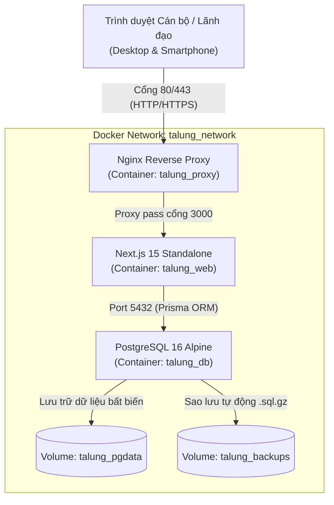

# TALUNG-CUS-WORK — HƯỚNG DẪN TRIỂN KHAI VẬN HÀNH PRODUCTION (DEPLOYMENT GUIDE)

> **Hệ thống:** Quản lý Kế hoạch & Điều hành Tác nghiệp Hải quan Cửa khẩu Quốc tế Tà Lùng  
> **Phiên bản:** `v1.2.4-TL (Enterprise Production Build)`  
> **Kiến trúc:** Next.js 15 Standalone + PostgreSQL 16 Alpine + Nginx Reverse Proxy (Dockerized)  
> **Cập nhật:** 10/10/2026

---

## 1. YÊU CẦU PHẦN CỨNG & HỆ ĐIỀU HÀNH TỐI THIỂU

| Thành phần | Cấu hình đề xuất (Production) | Cấu hình tối thiểu (Staging/LAN) |
| :--- | :--- | :--- |
| **CPU** | 4 Cores (Intel Xeon / Core i5 trở lên) | 2 Cores |
| **RAM** | 8 GB RAM | 4 GB RAM |
| **Ổ cứng** | 100 GB SSD (Enterprise / NVMe) | 50 GB SSD |
| **Hệ điều hành** | Ubuntu Server 22.04 LTS / Debian 12 / RHEL 9 | Ubuntu / Windows Server 2022 |
| **Môi trường** | Docker Engine 24+ & Docker Compose v2+ | Docker Engine 24+ |
| **Mạng** | IP tĩnh nội bộ, mở cổng 80 & 443 | Mạng LAN nội bộ Chi cục |

---

## 2. KIẾN TRÚC CỤM CONTAINER (DOCKER ARCHITECTURE)



---

## 3. CÁC BƯỚC TRIỂN KHAI CHI TIẾT (STEP-BY-STEP)

### BƯỚC 1: TẢI MÃ NGUỒN VÀO MÁY CHỦ
Đăng nhập vào máy chủ qua SSH và tạo thư mục triển khai:
```bash
sudo mkdir -p /opt/talung-cus-work
cd /opt/talung-cus-work
# Clone hoặc giải nén mã nguồn vào thư mục này
```

### BƯỚC 2: THIẾT LẬP FILE BIẾN MÔI TRƯỜNG PRODUCTION
Sao chép mẫu cấu hình bảo mật:
```bash
cp .env.production.example .env.production
```
Mở file `.env.production` bằng `nano` hoặc `vim` và cập nhật các tham số thực tế:
```ini
POSTGRES_USER=talung_admin
POSTGRES_PASSWORD=MatKhauPhucTapBaoMatCucCao_2026!#
POSTGRES_DB=talung_cus_work

# Chuỗi ngẫu nhiên 256-bit tạo bằng lệnh: openssl rand -base64 32
JWT_SECRET=c2VjdXJlX2p3dF90YWx1bmdfY3VzdG9tc18yMDI2X2tleV9zdXBlcl9zZWNyZXQ=

# Tắt tài khoản demo khi đưa vào vận hành thật
ENABLE_DEMO_LOGIN=false
NEXT_PUBLIC_ENABLE_DEMO_LOGIN=false
```

### BƯỚC 3: XÂY DỰNG IMAGE & KHỞI CHẠY HỆ THỐNG
Thực thi lệnh Docker Compose để build và kích hoạt 3 container:
```bash
docker compose -f docker-compose.prod.yml --env-file .env.production up -d --build
```
Kiểm tra trạng thái hoạt động:
```bash
docker compose -f docker-compose.prod.yml ps
```
*Kết quả kỳ vọng:* Cả 3 container `talung_db`, `talung_web`, `talung_proxy` đều có trạng thái `Up` (healthy).

### BƯỚC 4: KHỞI TẠO CƠ SỞ DỮ LIỆU & CHẠY MIGRATIONS
Chạy Prisma migration bên trong container ứng dụng để tự động khởi tạo bảng:
```bash
docker exec -it talung_web npx prisma migrate deploy
```
*(Tùy chọn) Nạp dữ liệu danh mục ban đầu (nếu cần):*
```bash
docker exec -it talung_web npx tsx prisma/seed.ts
```

---

## 4. CẤU HÌNH BẢO MẬT HTTPS/SSL (TÙY CHỌN NÂNG CAO)

Nếu triển khai qua mạng có cấp chứng chỉ SSL:
1. Đặt 2 file chứng chỉ vào thư mục `nginx/certs/`:
   - `talung.crt`: Chứng chỉ công khai (Certificate).
   - `talung.key`: Khóa bí mật (Private Key).
2. Chỉnh sửa `nginx/conf.d/talung.conf` để mở cổng `listen 443 ssl http2;`.
3. Tải lại cấu hình Nginx mà không cần ngắt kết nối:
   ```bash
   docker exec talung_proxy nginx -s reload
   ```

---

## 5. CẤU HÌNH TỰ ĐỘNG SAO LƯU DỮ LIỆU ĐỊNH KỲ (AUTOMATED BACKUP)

Hệ thống đã cung cấp script `scripts/backup-db.sh` hỗ trợ tự động:
- Trích xuất toàn bộ dữ liệu sạch `pg_dump`.
- Nén gzip mức 9 (`.sql.gz`).
- Tự động xóa các bản sao lưu cũ hơn 30 ngày.

### Thiết lập Cron Job trên máy chủ Linux:
Cấp quyền thực thi cho script:
```bash
chmod +x /opt/talung-cus-work/scripts/backup-db.sh
chmod +x /opt/talung-cus-work/scripts/restore-db.sh
```
Mở cấu hình crontab máy chủ:
```bash
sudo crontab -e
```
Thêm dòng sau để tự động sao lưu vào lúc **00:00 hàng ngày**:
```cron
0 0 * * * /opt/talung-cus-work/scripts/backup-db.sh >> /var/log/talung_backup.log 2>&1
```

---

## 6. QUY TRÌNH PHỤC HỒI DỮ LIỆU KHẨN CẤP (DISASTER RECOVERY)

Khi cần khôi phục lại dữ liệu từ một bản backup trước đó (ví dụ sau sự cố phần cứng hoặc kiểm tra định kỳ):

```bash
# Cú pháp
sudo /opt/talung-cus-work/scripts/restore-db.sh /opt/talung/backups/talung_talung_cus_work_YYYYMMDD_HHMMSS.sql.gz
```
Hệ thống sẽ yêu cầu nhập xác nhận `DONG_Y` trước khi tiến hành ghi đè dữ liệu an toàn.

---

## 7. QUY TRÌNH CẬP NHẬN PHIÊN BẢN MỚI (ZERO-DOWNTIME UPDATE)

Khi có bản cập nhật mã nguồn mới:
```bash
# 1. Kéo mã nguồn mới
git pull origin main

# 2. Xây dựng lại container Web với bản dựng mới
docker compose -f docker-compose.prod.yml --env-file .env.production build web

# 3. Chạy cập nhật database migration (nếu có trường dữ liệu mới)
docker compose -f docker-compose.prod.yml --env-file .env.production run --rm web npx prisma migrate deploy

# 4. Khởi động lại dịch vụ với downtime tối thiểu (< 5 giây)
docker compose -f docker-compose.prod.yml --env-file .env.production up -d --no-deps web
```

---

## 8. LỆNH THAO TÁC QUẢN TRỊ THƯỜNG DÙNG

| Thao tác | Câu lệnh thực hiện |
| :--- | :--- |
| **Xem logs hệ thống thời gian thực** | `docker compose -f docker-compose.prod.yml logs -f web` |
| **Xem logs Nginx truy cập** | `docker compose -f docker-compose.prod.yml logs -f proxy` |
| **Khởi động lại toàn bộ dịch vụ** | `docker compose -f docker-compose.prod.yml restart` |
| **Kiểm tra tài nguyên RAM/CPU** | `docker stats talung_web talung_db talung_proxy` |
| **Truy cập dòng lệnh Database** | `docker exec -it talung_db psql -U talung_admin -d talung_cus_work` |

---
*Tài liệu này được bàn giao cho Quản trị viên Tin học Chi cục Hải quan Cửa khẩu Quốc tế Tà Lùng.*
