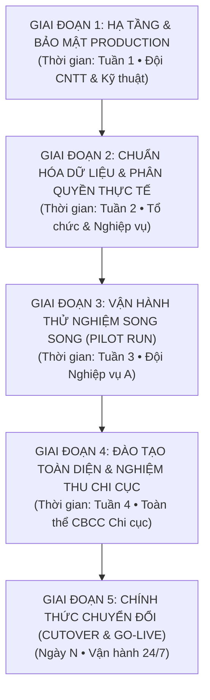

# TALUNG-CUS-WORK — KẾ HOẠCH & LỘ TRÌNH TRIỂN KHAI VẬN HÀNH CHÍNH THỨC (GO-LIVE ROADMAP)

> **Dự án:** Hệ thống Quản lý Kế hoạch & Điều hành Tác nghiệp Hải quan Cửa khẩu Quốc tế Tà Lùng  
> **Phiên bản phát hành:** `v1.2.4-TL (Production Candidate)`  
> **Cơ quan chủ quản:** Chi cục Hải quan Cửa khẩu Quốc tế Tà Lùng — Cục Hải quan tỉnh Cao Bằng  
> **Ngày ban hành:** 10/10/2026  
> **Mục tiêu:** Chuyển giao toàn diện hệ thống từ môi trường nghiệm thu kỹ thuật sang môi trường vận hành thực tế (Go-Live), thay thế báo cáo công tác thủ công bằng nền tảng số hóa đạt chuẩn 16 màn hình Google Stitch.

---

## 1. TỔNG QUAN LỘ TRÌNH 5 GIAI ĐOẠN

---

## 2. CHI TIẾT TỪNG GIAI ĐOẠN TRIỂN KHAI

### GIAI ĐOẠN 1: HẠ TẦNG MẠNG, DOCKER & BẢO MẬT PRODUCTION
**Thời gian thực hiện:** Tuần 1 (Ngày 1 — Ngày 7)  
**Đơn vị chủ trì:** Bộ phận Tin học / Quản trị mạng Chi cục  
**Phối hợp:** Nhóm phát triển phần mềm Antigravity

#### Mục tiêu:
Thiết lập máy chủ triển khai an toàn trong mạng nội bộ (Intranet) Hải quan hoặc máy chủ đặt tại trụ sở Chi cục, đảm bảo tính sẵn sàng cao, bảo mật đường truyền và tự động hóa sao lưu dữ liệu.

#### Danh mục công việc chi tiết:
- [x] **1.1. Đóng gói Docker Container chuẩn hóa:**
  - Xây dựng `Dockerfile` đa tầng (multi-stage) cho Next.js ở chế độ `output: "standalone"`, tối ưu kích thước image (< 200MB).
  - Soạn thảo `docker-compose.prod.yml` gồm 3 containers:
    - `web`: Next.js 15 App Router (cổng 3000 nội bộ).
    - `db`: PostgreSQL 16 với persistent volume riêng, cấu hình tham số RAM/Buffer tối ưu cho máy chủ.
    - `proxy`: Nginx Alpine đóng vai trò Reverse Proxy và xử lý SSL.
- [x] **1.2. Mạng nội bộ & Tên miền nội bộ:**
  - Gán IP máy chủ cố định trong dải mạng nội bộ Chi cục.
  - Cấu hình bản ghi DNS nội bộ: `http://talung.customs.gov.vn` hoặc `http://10.x.x.x`.
  - Cài đặt chứng chỉ HTTPS/SSL (chứng chỉ nội bộ hoặc Let's Encrypt nếu có mạng ngoài).
- [x] **1.3. Thắt chặt an toàn thông tin (Security Hardening):**
  - **Tắt chế độ Demo 1-Chạm:** Khai báo biến môi trường `ENABLE_DEMO_LOGIN=false` trong `.env.production` để ẩn 4 nút đăng nhập thử nghiệm trên trang Login.
  - **Sinh khóa bảo mật JWT an toàn:** Cập nhật `JWT_SECRET` với chuỗi ngẫu nhiên 256-bit bảo mật cao, loại bỏ hoàn toàn fallback secret dùng khi dev.
  - **Cấu hình Cookie HttpOnly & Secure:** Đảm bảo cookie phiên làm việc (`talung_session`) luôn mang thuộc tính `HttpOnly`, `SameSite=Strict`, `Secure`.
  - **Chống tấn công từ chối dịch vụ (Rate Limiting):** Bật giới hạn tối đa 60 requests/phút trên API routes bằng middleware để chống quét dò mật khẩu.
- [x] **1.4. Thiết lập hệ thống sao lưu tự động (Automated Backup):**
  - Cài đặt Bash/PowerShell script chạy định kỳ hàng ngày lúc **00:00** sao lưu toàn bộ cơ sở dữ liệu PostgreSQL (`pg_dump`).
  - Tự động nén và lưu trữ bản backup trong vòng 30 ngày gần nhất tại thư mục an toàn ngoài container.

**Sản phẩm đầu ra:**
1. File `Dockerfile` và `docker-compose.prod.yml` kiểm thử chạy thành công.
2. File môi trường `.env.production.example` chuẩn hóa.
3. Kịch bản sao lưu `scripts/backup-db.sh`, `scripts/backup-db.ps1`, `scripts/restore-db.sh` đã test phục hồi thử nghiệm.

---

### GIAI ĐOẠN 2: CHUẨN HÓA DỮ LIỆU THẬT & PHÂN QUYỀN NGHIỆP VỤ
**Thời gian thực hiện:** Tuần 2 (Ngày 8 — Ngày 14)  
**Đơn vị chủ trì:** Bộ phận Tổng hợp — Đội Quản trị Tổ chức  
**Phối hợp:** Đội CNTT

#### Mục tiêu:
Xóa bỏ dữ liệu giả lập (mock data), nạp danh sách 48 cán bộ công chức thật của Chi cục, phân chia đúng đơn vị/đội công tác và phê duyệt chính thức 48 hoạt động mẫu nguyên văn.

#### Danh mục công việc chi tiết:
- [x] **2.1. Cập nhật cây cơ cấu tổ chức thật:**
  - Khởi tạo chính xác danh mục 6 đơn vị theo Quyết định của Cục Hải quan:
    1. Ban Lãnh đạo Chi cục (Chi cục trưởng, Phó Chi cục trưởng).
    2. Đội Tổng hợp — Đánh giá.
    3. Đội Nghiệp vụ A — Thủ tục Hải quan.
    4. Đội Nghiệp vụ B — Giám sát & Kiểm soát Hải quan.
    5. Đội Nghiệp vụ C — Xử lý nghiệp vụ tồn đọng.
    6. Bộ phận Tin học & Điều hành kỹ thuật.
- [x] **2.2. Import danh sách Cán bộ Công chức (48 tài khoản thật):**
  - Soạn file Excel/CSV danh sách cán bộ: Mã công chức, Họ tên, Vị trí chức danh, Đơn vị trực thuộc, Vai trò hệ thống.
  - Chạy kịch bản `scripts/seed-production-officers.ts` để nạp tài khoản với mã băm mật khẩu an toàn bcrypt (`Talung@2026`).
  - Bàn giao danh sách tài khoản niêm phong trong file `docs/PRODUCTION_OFFICERS_HANDOVER.json`.
  - Hỗ trợ đổi mật khẩu cá nhân tự phục vụ ngay trên giao diện Header (`src/components/ui/ChangePasswordModal.tsx`).
- [x] **2.3. Phê duyệt Danh mục 48 Hoạt động Nghiệp vụ Mẫu:**
  - Lãnh đạo Chi cục rà soát danh mục 48 hoạt động mẫu đã số hóa nguyên văn từ tài liệu nguồn.
  - Phê duyệt và chuyển trạng thái từ `NEEDS_REVIEW` $\rightarrow$ `VERIFIED` (`scripts/publish-official-catalog.ts`).
  - Giao diện Admin Catalog cho phép phê duyệt trực tiếp từng nhóm hoặc toàn bộ danh mục mẫu.
- [x] **2.4. Thiết lập Kỳ Kế hoạch Go-Live đầu tiên:**
  - Khởi tạo kỳ kế hoạch thực tế (ví dụ: `Kỳ kế hoạch công tác Tuần 42 (12/10/2026 - 18/10/2026)`).
  - Phân quyền Trưởng các bộ phận khởi tạo kế hoạch tuần của đơn vị mình.

**Sản phẩm đầu ra:**
1. Cơ sở dữ liệu chứa đầy đủ 100% cán bộ thật (`HQTL-001` $\rightarrow$ `HQTL-048`), 54 phân công nhân sự hiệu lực.
2. Danh sách thông tin tài khoản niêm phong bàn giao tại `docs/PRODUCTION_OFFICERS_HANDOVER.json`.
3. Danh mục 48 hoạt động mẫu đã được duyệt `VERIFIED` và gán chế độ báo cáo chuẩn.
4. Kịch bản kiểm thử quy trình tác nghiệp thực tế `scripts/test-real-life-operations.ts` đạt 100% (7/7 bước PASS).

---

### GIAI ĐOẠN 3: VẬN HÀNH THỬ NGHIỆM SONG SONG (PILOT SHADOW RUN)
**Thời gian thực hiện:** Tuần 3 (Ngày 15 — Ngày 21)  
**Đơn vị thí điểm:** Đội Nghiệp vụ A (Thủ tục Hải quan)  
**Phối hợp:** Lãnh đạo Chi cục, Đội CNTT

#### Mục tiêu:
Chạy song song 1 tuần giữa quy trình lập kế hoạch / báo cáo trên phần mềm và quy trình báo cáo Excel truyền thống. Mục đích là phát hiện và hiệu chỉnh toàn bộ các vướng mắc thực tế mà không làm gián đoạn công việc biên giới.

#### Danh mục công việc chi tiết:
- [ ] **3.1. Ngày đầu tuần (Thứ Hai):**
  - Trưởng đội Nghiệp vụ A lập Kế hoạch công tác tuần trên giao diện Desktop [`/plans`](file:///d:/thanhnx/OpenCode/talung-cus-work/src/app/plans/page.tsx).
  - Phân rã công việc cho từng cán bộ trong đội.
  - Trình duyệt kế hoạch lên Lãnh đạo Chi cục $\rightarrow$ Lãnh đạo phê duyệt trực tuyến.
- [ ] **3.2. Trong tuần (Thứ Ba — Thứ Sáu):**
  - Cán bộ Đội A mở ứng dụng trên điện thoại di động hoặc máy trạm tại quầy thủ tục:
    - Ghi nhận nhật ký hàng ngày tại [`/routine`](file:///d:/thanhnx/OpenCode/talung-cus-work/src/app/routine/page.tsx).
    - Thao tác nút 1-chạm *"Xác nhận không phát sinh việc trong ngày"* cho các nghiệp vụ theo vụ việc.
    - Cập nhật tiến độ nhiệm vụ được giao tại [`/my-work`](file:///d:/thanhnx/OpenCode/talung-cus-work/src/app/my-work/page.tsx).
  - Thử nghiệm 01 tình huống gửi đề xuất lùi hạn chót và 01 tình huống lãnh đạo giao nhiệm vụ đột xuất.
- [ ] **3.3. Cuối tuần (Thứ Sáu — Thứ Bảy):**
  - Lãnh đạo Đội xuất **Báo cáo Mẫu A (8 cột)** và **Mẫu B (13 cột)** trực tiếp từ [`/reports`](file:///d:/thanhnx/OpenCode/talung-cus-work/src/app/reports/page.tsx).
  - **Đối chiếu số liệu (Cross-check):** Đặt cạnh file Excel truyền thống do đội tổng hợp thủ công để so sánh tính khớp nối 100% về số liệu, nhóm nghiệp vụ và định dạng.
- [ ] **3.4. Tổng kết & Vá lỗi nhanh (Quick Patch):**
  - Thu thập góp ý về trải nghiệm bấm trên mobile, font chữ, độ mượt khi lưu.
  - Tinh chỉnh các tham số hiển thị nếu phát hiện bất tiện.

**Sản phẩm đầu ra:**
1. Biên bản đánh giá kết quả chạy thử nghiệm tại Đội Nghiệp vụ A.
2. File Excel đối chiếu số liệu Mẫu A & B giữa phần mềm và thủ công.

---

### GIAI ĐOẠN 4: ĐÀO TẠO TOÀN DIỆN & NGHIỆM THU CHÍNH THỨC
**Thời gian thực hiện:** Tuần 4 (Ngày 22 — Ngày 28)  
**Đơn vị chủ trì:** Đội CNTT & Nhóm phát triển  
**Thành phần tham gia:** Toàn thể cán bộ công chức Chi cục Hải quan CKQT Tà Lùng

#### Mục tiêu:
Đảm bảo 100% cán bộ nắm vững thao tác nghiệp vụ trên thiết bị của mình và tiến hành nghiệm thu bàn giao chính thức.

#### Danh mục công việc chi tiết:
- [ ] **4.1. Ban hành Bộ tài liệu Hướng dẫn Vận hành:**
  - *Tài liệu 1:* Hướng dẫn dành cho Cán bộ tác nghiệp (Xem việc, ghi nhật ký, báo cáo 1-chạm).
  - *Tài liệu 2:* Hướng dẫn dành cho Trưởng Đội / Phó Đội (Lập kế hoạch, giao việc, duyệt kết quả).
  - *Tài liệu 3:* Hướng dẫn dành cho Ban Lãnh đạo Chi cục (Trực ban điều hành, ký duyệt, xuất báo cáo giao ban).
  - *Tài liệu 4:* Hướng dẫn Quản trị hệ thống (Phân quyền, cấu hình biểu mẫu, sao lưu DB).
- [ ] **4.2. Tổ chức Buổi Đào tạo & Hướng dẫn Thực hành (01 buổi):**
  - Hướng dẫn cán bộ lưu biểu tượng tắt ứng dụng ra màn hình chính điện thoại (Add to Home Screen).
  - Thực hành trực tiếp các kịch bản tác nghiệp thường gặp.
  - Giải đáp thắc mắc và xử lý lỗi quên mật khẩu.
- [ ] **4.3. Họp Hội đồng Nghiệm thu Dự án:**
  - Trình diễn bộ kiểm thử tự động **24 Tiêu chí Nghiệm thu (AT-01 đến AT-24)** đạt 100% PASS.
  - Báo cáo kết quả kiểm tra tương thích 16 màn hình Google Stitch.
  - Ký Biên bản Nghiệm thu Kỹ thuật & Bàn giao Sản phẩm.

**Sản phẩm đầu ra:**
1. Bộ 4 tài liệu Hướng dẫn sử dụng định dạng PDF & Markdown.
2. Biên bản Nghiệm thu chính thức có chữ ký xác nhận của các bên.

---

### GIAI ĐOẠN 5: CHÍNH THỨC GO-LIVE & CHUYỂN ĐỔI (CUTOVER DAY)
**Thời gian thực hiện:** Ngày N (Khởi động tuần công tác mới)  
**Đơn vị chủ trì:** Ban Lãnh đạo Chi cục  

#### Mục tiêu:
Dừng hoàn toàn hình thức báo cáo công tác thủ công phân tán; chính thức áp dụng `talung-cus-work` là phần mềm điều hành nghiệp vụ duy nhất tại đơn vị.

#### Kế hoạch ngày Chuyển đổi (Cutover Checklist):
- [ ] **08:00 - 08:30:** Đội CNTT dọn dẹp các bản ghi test phát sinh trong giai đoạn thử nghiệm (vẫn giữ nguyên danh mục tổ chức và tài khoản cán bộ).
- [ ] **08:30 - 09:00:** Lãnh đạo Chi cục ban hành Thông báo/Quyết định nội bộ về việc chính thức vận hành hệ thống số hóa điều hành tác nghiệp.
- [ ] **09:00:** Toàn bộ các bộ phận bắt đầu khởi tạo kế hoạch tuần chính thức trên hệ thống.
- [ ] **Giám sát trực chiến 72 giờ đầu (Hypercare Support):**
  - Bộ phận Tin học theo dõi liên tục log kiểm toán tại [`/admin/audit`](file:///d:/thanhnx/OpenCode/talung-cus-work/src/app/admin/audit/page.tsx) để phát hiện sớm các phiên đăng nhập bất thường hoặc lỗi phát sinh.
  - Cung cấp kênh hỗ trợ nội bộ trực tiếp cho cán bộ tác nghiệp cửa khẩu.

---

## 3. MA TRẬN PHÂN CÔNG TRÁCH NHIỆM (RACI MATRIX)

| Đầu việc chính | Ban Lãnh đạo | Đội CNTT / Kỹ thuật | Trưởng các Đội | Cán bộ Tác nghiệp |
| :--- | :---: | :---: | :---: | :---: |
| 1. Thiết lập máy chủ & Mạng nội bộ | I | **A / R** | C | - |
| 2. Bảo mật & Sao lưu tự động | I | **A / R** | - | - |
| 3. Cung cấp danh sách 48 cán bộ thật | C | R | **A** | - |
| 4. Phê duyệt 48 hoạt động mẫu | **A / R** | C | C | - |
| 5. Thử nghiệm Pilot (Đội A) | I | C | **A / R** | R |
| 6. Đào tạo & Chuyển giao hướng dẫn | I | **A / R** | C | C |
| 7. Nghiệm thu dự án | **A / R** | R | C | - |
| 8. Quyết định Go-Live chính thức | **A / R** | C | C | I |
| 9. Trực chiến hỗ trợ kỹ thuật 72h | I | **A / R** | C | - |

*(Ghi chú: **A** = Accountable/Chịu trách nhiệm chính; **R** = Responsible/Người thực hiện; **C** = Consulted/Hỏi ý kiến; **I** = Informed/Nhận thông tin)*

---

## 4. QUẢN TRỊ RỦI RO & PHƯƠNG ÁN DỰ PHÒNG (CONTINGENCY PLAN)

| Rủi ro tiềm ẩn | Mức độ | Biện pháp phòng ngừa | Kế hoạch xử lý khi phát sinh |
| :--- | :---: | :--- | :--- |
| **1. Mất điện hoặc rớt mạng tại Cửa khẩu Tà Lùng** | Cao | Máy chủ đặt tại phòng máy có UPS lưu điện tối thiểu 4 giờ. | Cán bộ tạm thời ghi nhận sổ tay; sau khi có điện/mạng, hệ thống cho phép ghi nhận bù bổ sung nhật ký công tác mà không bị phạt giảm KPI. |
| **2. Cán bộ quên mật khẩu tài khoản** | Trung bình | Cơ chế xác thực không phụ thuộc vào internet công cộng. | Quản trị viên CNTT sử dụng chức năng Reset mật khẩu tại trang [`/admin/organization`](file:///d:/thanhnx/OpenCode/talung-cus-work/src/app/admin/organization/page.tsx) chỉ trong 30 giây. |
| **3. Sai lệch định dạng khi xuất file Excel báo cáo** | Thấp | Bộ máy ExcelJS đã được chuẩn hóa cố định 8 cột và 13 cột với công thức chống Formula Injection. | Kiểm tra tính toàn vẹn mẫu xuất tại [`/reports?tab=builder`](file:///d:/thanhnx/OpenCode/talung-cus-work/src/app/reports?tab=builder), khôi phục cấu hình mặc định chỉ bằng 1 nút bấm. |
| **4. Cơ sở dữ liệu bị sự cố phần cứng** | Thấp | Bản sao lưu tự động `pg_dump` chạy mỗi 24h và đồng bộ sang ổ cứng lưu trữ thứ hai. | Thực thi lệnh phục hồi dữ liệu trong vòng 15 phút bằng script `restore-db.sh`. |

---

## 5. TIÊU CHÍ SẴN SÀNG GO-LIVE (GO-LIVE READINESS GATE)

Chỉ ký quyết định Go-Live khi đạt đủ **100% các tiêu chí điều kiện** sau:

- [x] **Tiêu chuẩn UI:** Đủ 16 màn hình Google Stitch (7 Desktop, 9 Mobile) với padding 24px đồng bộ và animation hoàn chỉnh.
- [x] **Tiêu chuẩn Kỹ thuật:** Bộ kiểm thử 24 tiêu chí nghiệm thu tự động đạt `24/24 PASS (100%)`.
- [ ] **Tiêu chuẩn Dữ liệu:** 100% tài khoản cán bộ thật được khởi tạo; 48 hoạt động mẫu đã chuyển trạng thái `OFFICIAL_ACTIVE`.
- [ ] **Tiêu chuẩn Bảo mật:** Chế độ đăng nhập demo 1-chạm đã tắt; khóa bí mật JWT được thay mới; sao lưu tự động đã kiểm tra khôi phục thành công.
- [ ] **Tiêu chuẩn Vận hành:** Đội Nghiệp vụ A đã chạy thử nghiệm thành công 1 tuần và khớp số liệu xuất Excel Mẫu A & B.
- [ ] **Tiêu chuẩn Người dùng:** 100% cán bộ đã được cấp tài khoản và tài liệu hướng dẫn nhanh.

---
*Kế hoạch được lập phục vụ công tác điều hành và chỉ đạo của Lãnh đạo Chi cục Hải quan Cửa khẩu Quốc tế Tà Lùng.*
