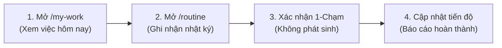

# TALUNG-CUS-WORK — CẨM NANG HƯỚNG DẪN TÁC NGHIỆP DÀNH CHO CÁN BỘ CÔNG CHỨC
*(Sổ tay bỏ túi 1-chạm — Áp dụng tại Chi cục Hải quan Cửa khẩu Quốc tế Tà Lùng)*

---

## 1. ĐĂNG NHẬP HỆ THỐNG & ĐỔI MẬT KHẨU
1. **Truy cập:** Mở trình duyệt trên máy trạm hoặc điện thoại thông minh $\rightarrow$ Nhập địa chỉ: `http://talung.customs.gov.vn` (hoặc IP mạng nội bộ).
2. **Tên đăng nhập:** Mã công chức viết thường (Ví dụ: `hqtl012`).
3. **Mật khẩu ban đầu:** Cấp qua niêm phong nội bộ (mặc định: `Talung@2026`).
4. **Đổi mật khẩu:** Sau khi đăng nhập thành công, bấm vào nút **[Đổi MK]** (biểu tượng chìa khóa 🔑 trên thanh Header) $\rightarrow$ Nhập mật khẩu cá nhân mới (tối thiểu 8 ký tự).

---

## 2. QUY TRÌNH HÀNG NGÀY TRÊN ĐIỆN THOẠI DI ĐỘNG (MOBILE)

### BƯỚC 1: XEM CÔNG VIỆC TRONG NGÀY
- Vào mục **"Việc của tôi"** ([`/my-work`](file:///d:/thanhnx/OpenCode/talung-cus-work/src/app/my-work/page.tsx)):
  - Hiển thị toàn bộ các đầu việc được Đội trưởng phân công hoặc Chi cục trưởng chỉ đạo.
  - Các đầu việc có cờ **Khẩn cấp** hoặc sắp đến hạn chót sẽ được đưa lên đầu danh sách.

### BƯỚC 2: GHI NHẬT KÝ TÁC NGHIỆP ([`/routine`](file:///d:/thanhnx/OpenCode/talung-cus-work/src/app/routine/page.tsx))
- Chọn **"Ghi nhận nhật ký hàng ngày"**:
  - Chọn mã hoạt động tương ứng (ví dụ: Tiếp nhận tờ khai, kiểm tra thực tế hàng hóa, soi chiếu container, trực barie cửa khẩu).
  - Điền số lượng hồ sơ / lượt phương tiện đã xử lý trong ca trực.
  - Bấm **"Lưu nhật ký"**.

### BƯỚC 3: THAO TÁC 1-CHẠM KHI KHÔNG CÓ VỤ VIỆC PHÁT SINH
> **Lưu ý nghiệp vụ:** Đối với các nghiệp vụ thực hiện theo vụ việc (chống buôn lậu, xử lý vi phạm, xử lý tồn đọng) nếu trong ca trực không phát sinh:
- **KHÔNG CẦN TẠO SỐ LIỆU ẢO.**
- Chỉ cần bấm nút: **"1-Chạm xác nhận không phát sinh việc trong ngày"**.
- Hệ thống sẽ tự động xác nhận hoàn thành nghĩa vụ theo dõi mà **không làm giảm điểm KPI**.

### BƯỚC 4: BÁO CÁO HOÀN THÀNH & ĐÍNH KÈM KẾT QUẢ
- Khi hoàn tất nhiệm vụ:
  - Bấm vào đầu việc $\rightarrow$ Chọn **"Cập nhật tiến độ"** $\rightarrow$ Kéo thanh trượt lên **100%**.
  - Nhập tóm tắt kết quả (ví dụ: *"Đã hoàn thành thông quan 12 lô hàng nông sản"*).
  - Trạng thái sẽ tự động chuyển sang **"Chờ lãnh đạo nghiệm thu"** (`WAITING_REVIEW`).

---

## 3. ĐỀ XUẤT XIN GIA HẠN THỜI HẠN (KHI GẶP VƯỚNG MẮC)
Nếu nhiệm vụ phát sinh vướng mắc khách quan (chờ kết quả giám định, doanh nghiệp chậm bổ sung chứng từ C/O):
1. Bấm nút **"Xin gia hạn thời hạn"** trên chi tiết nhiệm vụ.
2. Chọn thời hạn mới đề xuất và nhập rõ lý do khách quan.
3. Hệ thống sẽ giữ nguyên thời hạn gốc (`originalDeadline`) để bảo toàn tính minh bạch và gửi yêu cầu tới Trưởng đội xét duyệt.

---
*Mọi vướng mắc về tài khoản, vui lòng liên hệ Bộ phận CNTT Chi cục (Đ/c Nguyễn Hoàng Nam).*
